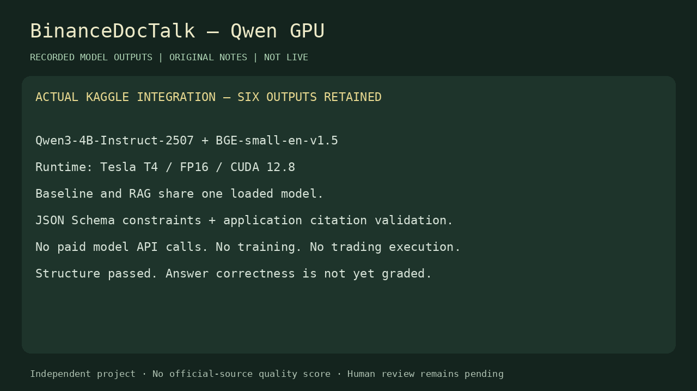
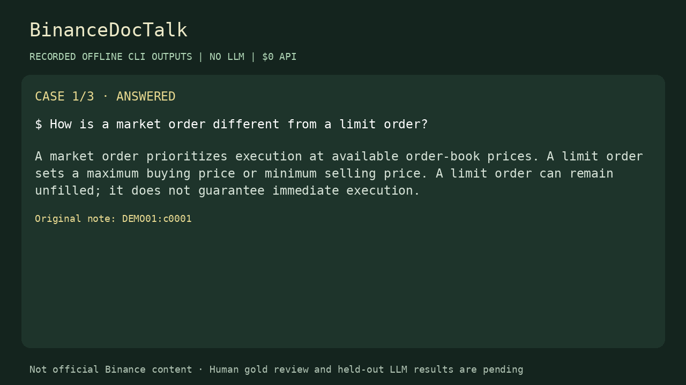
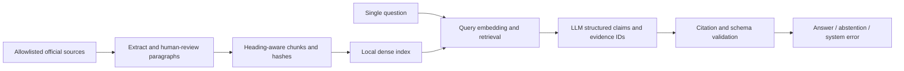

# BinanceDocTalk

**Evidence-grounded crypto education, with inspectable citations and an evaluation workflow.**

Independent educational portfolio project. **Not affiliated with, sponsored by, or endorsed by Binance. Not investment advice.**

## Project status

The application, offline demonstration, official-source ingestion/indexing path, paid API adapter,
and paired evaluation tooling are implemented. **The official-source quality study is not complete.**

| Deliverable | Current status |
|---|---|
| Dependency-free local application and CLI | Implemented; core behavior tested |
| Offline demonstration | Runs on 12 original synthetic notes, with no LLM or API charges |
| Official source manifests | 20 candidate URLs plus actual snapshot timestamps/hashes; raw text excluded from Git |
| HF import | 15 separate source candidates and 12 development QA candidates; pinned Parquet, no automatic adoption. [Workflow](docs/huggingface_workflow.md) |
| Benchmark | 92 v2 drafts: 10 smoke / 36 dev / 46 test; labels and test types separated; human review pending |
| Official corpus collection | 20 web-reader snapshots; curated v2 retains 477 of 481 paragraphs, with a versioned edit log; human review pending. [Provenance](docs/collection_workflow.md) |
| Local Qwen + BGE integration | Verified on Kaggle GPU: 67 tests pass, six original-note outputs validated; semantic quality ungraded |
| Live OpenAI integration | Implemented and mock-tested; no API key available for a live check |
| Held-out quality, latency, cost | **Not measured**; no claims of improvement |
| GitHub repository | Pushed to [An-devAI/BinanceDocTalk](https://github.com/An-devAI/BinanceDocTalk); official quality study remains pending |

See [verification evidence](docs/verification.md), [evaluation protocol](docs/evaluation.md),
and [remaining acceptance steps](docs/roadmap.md). Unit tests and the offline preview are **not**
evidence of official-corpus answer quality.

**Kaggle GPU verification:** pinned Qwen3-4B and BGE completed actual retrieval and generation on
Tesla T4 / FP16 / CUDA 12.8. All 67 tests and six structured-output checks passed in the submitted
snapshot. See [run evidence](docs/kaggle_gpu_run.json), [local inference](docs/local_inference.md),
and [the full outputs and limitations](demo/gpu-recorded-preview.html). This is a synthetic
integration check, **not an answer-accuracy or citation-support benchmark**. No paid model API calls.

Watch the [30-second recorded GPU walkthrough](demo/gpu-walkthrough.webm). All six outputs,
including imperfect model behavior, are retained in [recorded JSON](demo/gpu-recorded-results.json).



## Run in under a minute

Watch the [27-second recorded offline walkthrough](demo/offline-walkthrough.webm), or open
the [standalone recorded preview](demo/recorded-preview.html) directly in your browser.
These replay real CLI outputs on original notes; they are not live LLM inference.



Requires Python 3.11+. The default CLI and browser UI use only the Python standard library.
Run these commands from the project directory:

```bash
python3 scripts/doctalk.py doctor
python3 scripts/doctalk.py demo
python3 web_app.py
```

Open **http://127.0.0.1:8765**. Use `--port 8766` if that port is occupied.
The server binds only to loopback; do not expose this development server publicly.
The implementation sandbox blocks listening sockets, so server binding must be checked on your machine.

Try:

- `How is a market order different from a limit order?`
- `A stop-limit order guarantees execution after triggering, right?`
- `What is the exact Spot fee for my account today?`

Offline output is retrieved original prose, not LLM synthesis. Its simple lexical abstention logic
is illustrative and is not a calibrated uncertainty estimator.

For the optional Streamlit interface:

```bash
python3 -m venv .venv
source .venv/bin/activate
python -m pip install -r requirements-ui.lock.txt
streamlit run app.py
```

The core `uv.lock` has no runtime dependencies. The optional UI/tokenizer stack is transitively
pinned in `requirements-ui.lock.txt` for Python 3.12 on Linux. Streamlit 1.66.1 and tiktoken 0.14.0
were actually installed and exercised through Streamlit AppTest (answer, citation and abstention).
This is runtime testing, not browser visual QA. Other platforms can resolve the separate input
requirements. The optional local-model stack has pinned model revisions and top-level package
versions; the actual Kaggle environment is recorded with its run evidence.

```bash
python scripts/check_optional_ui.py
```

## Problem and scope

Answer English educational questions about basic crypto terminology, unleveraged Spot,
order books, liquidity, spread/slippage, maker/taker, market/limit/stop-limit/OCO,
and introductory GTC/IOC/FOK. Each question is independent; chat history is not model context.

The system does not execute trades, predict prices, recommend investments, inspect accounts,
provide current fees, determine regional eligibility, or explain detailed derivatives mechanics.
Source material is a dated knowledge snapshot, not a live exchange specification.

## Architecture



Dense search uses normalized vectors and cosine similarity. This corpus does not need a vector
database. An inspectable BM25 implementation is the retrieval-only baseline. Each chunk retains
document hash and paragraph character spans, allowing evidence coverage to be checked independently
of chunk boundaries. Similarity is not displayed as a confidence probability.

Model output has `status`, `reason`, `message`, and `claims`. Answered output contains only atomic
claims with evidence IDs; uncited prose cannot hide in `message`. The application resolves IDs
to URLs itself. Syntactically valid citations **can still support the wrong claim**; this is graded
separately. Provider errors and rejected citations never count as successful knowledge abstention.

### Implementation choices

To keep the core runnable without package downloads, dataclasses and explicit validation replace
Pydantic, and a small REST adapter replaces the OpenAI SDK. TOML replaces YAML. Dense dot products
and BM25 use the standard library at this scale. An optional Streamlit UI is included alongside
the dependency-free UI. Kaggle configurations use the BGE tokenizer so 400-token chunks fit the
embedding model; optional OpenAI configurations use `cl100k_base`. The offline preview explicitly
records its different `regex_word_v1` tokenizer. Local Qwen generation uses a GPU while BGE runs
on CPU, and paired experiment arms share the loaded model weights.

These changes reduce installation requirements. They do not turn the synthetic preview into a
substitute for the official RAG experiment. Dependencies or frameworks should be added only for a
measured need.

## Official-source study with local models

Human review is pending by the owner’s choice. The retrieved snapshots and review packets are
local; see [collection and review](docs/collection_workflow.md). After actual review, use a GPU
runtime with `requirements-local-model.txt` installed:

```bash
python scripts/doctalk.py build --corpus data/local/corpus.reviewed.v2.jsonl \
  --config configs/kaggle-rag.toml --output data/local/index.local.v2.json
python scripts/doctalk.py ask "Why can a stop-limit order remain unfilled?" \
  --config configs/kaggle-rag.toml --index data/local/index.local.v2.json
```

No OpenAI key is used for this backend. Continue with the paired k=3/k=5 configurations and review,
freeze, and grading procedures in [local inference](docs/local_inference.md) and
[evaluation](docs/evaluation.md). A GPU notebook is a batch execution environment, not public web hosting.

## Optional OpenAI workflow

1. Read [data rights and provenance](docs/dataset_card.md). Check applicable terms and permitted
   collection/API processing yourself. No redistribution permission is asserted by this repository.
2. Copy `.env.example` to `.env` and set `OPENAI_API_KEY` locally. Never paste a key into issues,
   transcripts, code, or benchmark questions. The app loads only this key from `.env` and does not
   execute shell expressions.
3. Install `requirements-tokenizer.txt`, then collect the explicitly allowlisted pages if permitted:

```bash
python3 scripts/doctalk.py collect --acknowledge-source-terms \
  --output data/local/corpus.raw.v1.jsonl
```

Collection checks robots policy, restricts redirects, avoids authenticated paths, and fails closed
on unreadable policies. It does not evade blocks. `--doc-id D15` can restrict a collection attempt.
Robots compliance is not a copyright licence or a substitute for checking the terms.
If collection is blocked, use lawfully obtained local HTML with `extract_html` or prepare the
document schema described in the dataset card; do not bypass the block.

4. Inspect extracted text and approve it through the human-operated helper:

```bash
python3 scripts/review_dataset.py sources \
  --input data/local/corpus.raw.v1.jsonl \
  --output data/local/corpus.reviewed.v1.jsonl --reviewer "Your name"
```

Do not approve promotional, unstable, incomplete, or conflicting material. Edit the source selection
and recollect a new version if extraction is wrong. Merely supplying a reviewer name does not verify facts.

5. Build the official dense index. This command makes paid embedding calls:

```bash
python3 scripts/doctalk.py build --corpus data/local/corpus.reviewed.v1.jsonl \
  --output data/local/index.v1.json
python3 scripts/doctalk.py ask "Why might an activated stop-limit order remain unfilled?"
python3 web_app.py --index data/local/index.v1.json
```

Generation defaults to `gpt-5.4-mini-2026-03-17`, reasoning `none`, maximum 1,000 output tokens.
Embeddings use `text-embedding-3-small`. There are no web/tools calls at answer time, no response
cache, a 30-second request timeout, and at most one retry for transient failures. Paid API access
and snapshot availability must be checked on your account before freezing the experiment.

Prices in configuration were checked on 2026-10-22: $0.75/M input, $4.50/M output, $0.02/M embedding
tokens. Recheck before use: [generation](https://developers.openai.com/api/docs/models/gpt-5.4-mini),
[embeddings](https://developers.openai.com/api/docs/models/text-embedding-3-small).
Structured output follows the [official JSON Schema interface](https://developers.openai.com/api/docs/guides/structured-outputs).

`artifacts/local/budget.json` reserves estimated worst-case request costs **before** every attempt,
including retries. Unknown usage after failures retains its reservation. The $10 local ceiling is
conservative bookkeeping, not a hard billing cap enforced by the provider. Do not delete the ledger
to hide spending. Inspect a stale `.lock` only after confirming no process is using it.

## Dataset and evaluation

An optional [pinned Hugging Face import](docs/huggingface_workflow.md) provides a separate
review pool: nine existing-URL mirror candidates, six supplemental articles and 12 development QA
candidates. Upstream answers are generated drafts; labels/types/evidence remain unassigned.
Public metadata records hashes and provenance; actual source/QA text stays local.

Corpus curation, gold review and held-out inference are separate milestones. The complete local
annotation packet is `artifacts/local/review-pack-v3/smoke.html`; it links to the entire corpus,
actual scope policy, all splits and the overlap audit. See [the curation log](docs/corpus_curation_v2.json).
The original v1 drafts and recorded GPU snapshots are retained as historical artifacts.

- **Retrieval corpus:** official source paragraphs, stored locally, never benchmark answers.
- **Benchmark:** separate questions, original reference answers, required points, answerability
  labels, grouped split IDs, and exact evidence spans.
- **Offline preview:** 12 original notes; isolated from both official assets.

The current v2 benchmark contains 56 answerable drafts, 12 in-scope evidence-gap candidates and
24 out-of-scope requests. `test_type` is independent of the answer label; prompt injection is a
test type, not a refusal reason. The 12 gap cases include whole-corpus lexical censuses and require
human absence/sufficiency review. Proposed source IDs are **not verified citations**.
Evidence groups intentionally remain empty until a human binds them.
Use [the review workflow](docs/evaluation.md) before measuring quality. Existing draft cases have
been visible to the implementation assistant; do not describe them as an independently blind benchmark.

The experiment compares model knowledge without retrieval against dense RAG using the same
generation settings. BM25 is a separate retrieval baseline. Tune only on dev, then freeze code,
data, prompts and configs. The official test runner records a consumed question-set identity
across freeze filenames and rejects overlapping consumed families. If test outputs informed tuning, create a new final set.

Current results:

| System | Full answer accuracy | Grounded success | Citation support | Abstention recall | p50 / p95 |
|---|---|---|---|---|---|
| No-retrieval LLM | Not measured | N/A | N/A | Not measured | Not measured |
| Official-source RAG | Not measured | Not measured | Not measured | Not measured | Not measured |

After producing a real report, load it into the local UI with
`python3 web_app.py --report artifacts/local/test-v2/metrics.json` to inspect the saved metrics.
It remains a report of its frozen run, not a measurement of a newly changed configuration.

These entries must remain unchanged until real inference and declared human grading have been
performed. Saved outputs permit offline recomputation; fresh API inference may differ.

## Tests

```bash
python3 -m unittest discover -s tests -v
python3 scripts/doctalk.py audit-benchmark
python3 -m compileall -q src scripts app.py web_app.py
```

Tests cover provenance, chunk boundaries, dense/BM25 ranking, citation rejection, API failures,
budgets, dataset leakage, human-review gates, scoring and held-out controls using original synthetic
fixtures. No secret or paid API is needed. GitHub Actions is configured for Python 3.11–3.13;
remote CI has not been run merely because a workflow file exists.

## Limitations and next steps

- Official-source collection, human source/gold review and live API verification are outstanding.
- Optional Streamlit/tiktoken environments require installation and experiment-specific locking.
- The local server is a development server, not a public production service.
- Structural validation cannot establish semantic entailment; abstention remains fallible.
- Small, owner-authored English benchmarks have broad uncertainty and do not represent user traffic.
- A public source may already be in model pretraining; held-out questions do not imply unseen facts.
- Source hashes detect changes but cannot reconstruct an old page. Redistributing snapshots requires permission.
- Embedding model aliases may change; record actual responses and local vector/index hashes.

After completing the study, prioritize more independently reviewed cases before adding retrieval
complexity. Hybrid retrieval, Vietnamese evaluation and hosted deployment are optional follow-ups.

## Personal contributions and AI-assisted development

The initial implementation and benchmark drafts were produced with an AI coding assistant.
Owner human review has not been impersonated. See [AI usage](docs/ai_usage.md) and
[CV/interview notes](docs/cv_and_interview.md). Claim personal decisions, verification work and
results only after actually performing them.

## Licensing

Original code: [MIT](LICENSE). Original benchmark drafts and demo notes:
[CC BY 4.0 notice](data/LICENSE.md). These licences do not cover Binance articles, trademarks,
or third-party source material. See [NOTICE](NOTICE.md).
